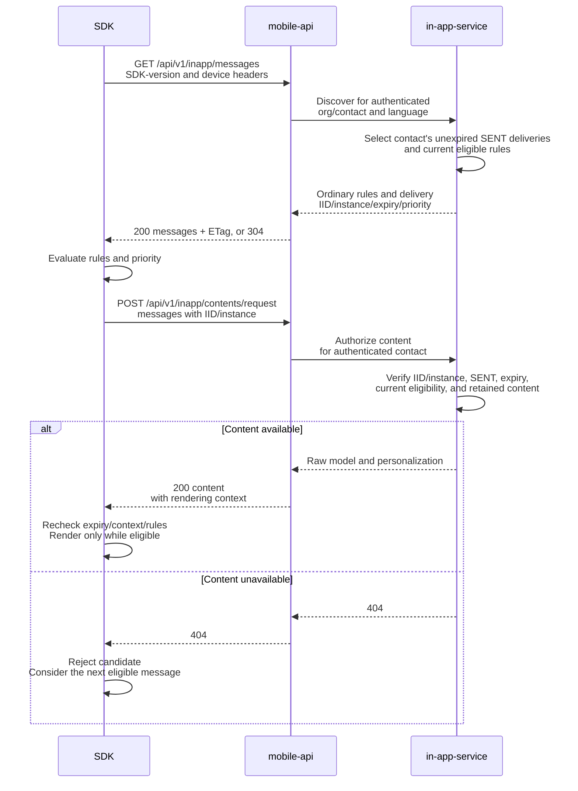
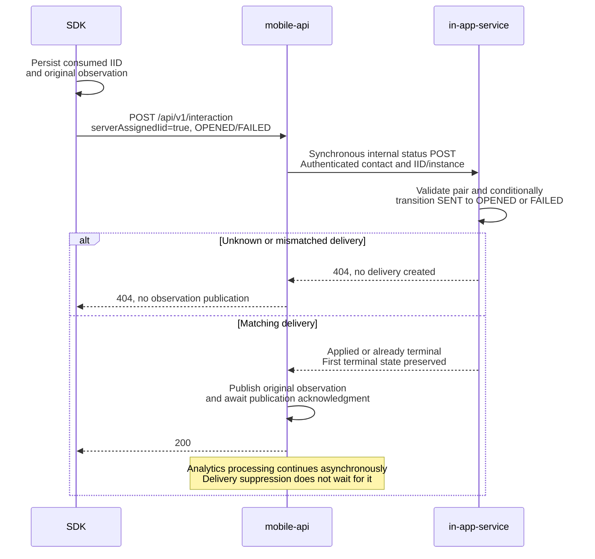
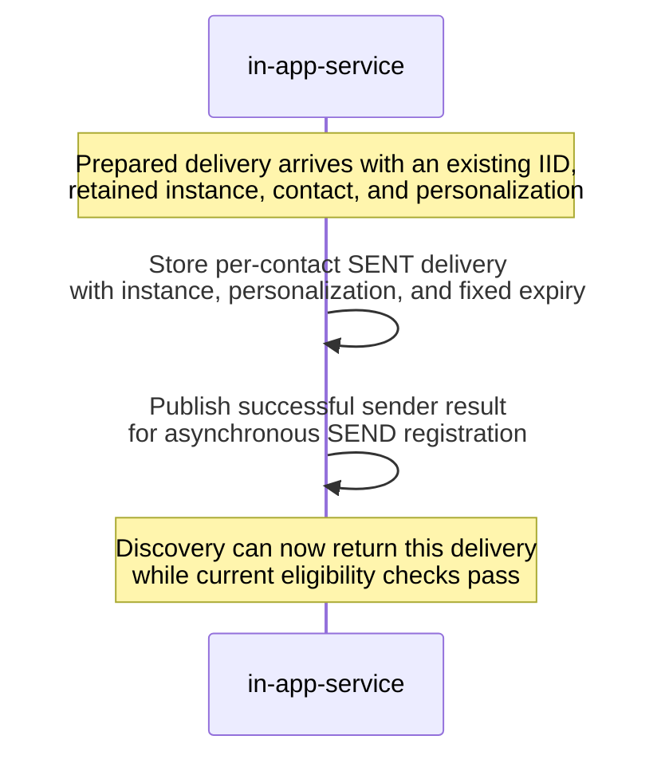

# Android SDK InApp delivery

The SDK implementation is committed in this checkout. The click transport contract was
updated on November 13, 2026. Native certification,
release, and coordinated backend deployment remain unverified by the recorded
checks.

You can review the SDK behavior and backend contract here without access to
another repository. Source and test links stay within this repository.

## Contents

- [What changes for the SDK](#what-changes-for-the-sdk)
- [Identifiers and service responsibilities](#identifiers-and-service-responsibilities)
- [SDK flow](#sdk-flow)
- [Public API compatibility](#public-api-compatibility)
- [Public endpoints: before and after](#public-endpoints-before-and-after)
- [Display rules and content](#display-rules-and-content)
- [Status, retries, and local state](#status-retries-and-local-state)
- [Android implementation](#android-implementation)
- [Verification status and remaining checks](#verification-status)
- [Backend reference](#backend-reference)
- [Review history](#review-history)
- [Verification history](#verification-history)

## What changes for the SDK

An ordinary InApp becomes eligible through published display rules, including
optional segment conditions. A workflow can now create a separate delivery for a
specific contact before that contact opens the app. This document calls it a
**server delivery**. A segment condition alone does not create one.

| Concern | Ordinary InApp before this change | Added behavior |
| --- | --- | --- |
| Identity | The SDK generates an interaction UUID for a display attempt. | The backend creates an interaction UUID before discovery; the SDK reuses it. |
| Eligibility | Published rules, targeting, segment membership, and frequency determine eligibility. | The contact needs an unexpired `SENT` delivery and a currently available instant message. Ordinary publication is not required. Current rules still apply; the backend disables only message-level frequency for these deliveries. |
| Content | A message instance is requested by `messageInstanceId`. | The same endpoint accepts an IID/instance pair and returns that delivery's prepared personalization. |
| Selection | Existing ordinary-message selection applies. | Eligible server deliveries take precedence over eligible ordinary messages. Higher numeric priority wins; visible content is not interrupted. |
| Observations | OPENED/FAILED use the mobile-api POST; clicks use the existing interaction-status transport. | OPENED/FAILED keep the mobile-api POST; ordinary and server-assigned clicks use the existing interaction-status PUT. Push and push-embedded InApp keep their existing transport. |
| Repeat behavior | Ordinary frequency rules control later displays. | OPENED, CLICKED, or FAILED consumes that particular delivery locally. Only server-assigned OPENED/FAILED ends server availability; a click does not change delivery state. Another delivery of the same message has another IID. |

The SDK does not choose or understand a workflow mode. It branches on whether an
IID was received, honors expiry and priority, and evaluates the supplied rules.
Do not add `inWorkflow`, `deliveryMethod`, or `includeWorkflow` to SDK requests.

## Identifiers and service responsibilities

| Owner | Responsibility relevant to the SDK |
| --- | --- |
| mobile-api | Authenticates the application/device, resolves the contact, gates discovery by SDK version, forwards content, completes server delivery state synchronously, and publishes observations. It also serves Mobile Push; this change does not move Push tracking into the InApp POST. |
| in-app-service | Receives prepared deliveries, stores per-contact availability, supplies discovery/content, and owns the terminal delivery state. |

| Identifier | Meaning and SDK use |
| --- | --- |
| `messageId` | The authored message. Used with its display rules; not a unique delivery. |
| `messageInstanceId` | A retained version of message content, including the selected language. Multiple deliveries can share it. |
| `iid` | The interaction UUID. For a server delivery it identifies one send to a contact, not the template. Preserve it for content lookup and every observation. Generate a UUID only when discovery supplied no IID. |
| `serverAssignedIid` | OPENED/FAILED POST boolean: `true` means the IID came from the server. Omitted/false retains the SDK-generated path. Persist provenance with retries; the click PUT omits this flag. Do not infer provenance from a UUID's format. |

An **observation** is the SDK's report of an OPENED, CLICKED, or FAILED event.
**Local suppression** means remembering that a server delivery's IID has already
been used, so the SDK does not show it again. A **terminal state** is OPENED or
FAILED in in-app-service; the delivery is no longer available to the contact.

## SDK flow

1. Fetch the discovery list. A supported SDK can receive ordinary messages and
   server deliveries together.
2. Evaluate the supplied rules and select the highest-priority eligible item.
   Server deliveries use priority `20`; ordinary messages use `10` by default.
3. Authorize a server delivery's content online using its IID and message
   instance. If it is unavailable, consider the next eligible candidate.
4. Display only while the candidate remains eligible. Preserve a received IID;
   generate an IID only for an ordinary display attempt.
5. Persist the observation with its original account context and retain the
   server delivery's local consumed-IID marker. Send OPENED/FAILED through the
   mobile-api POST with `serverAssignedIid=true`; mobile-api ends availability
   synchronously before acknowledgment. Send CLICKED through the existing PUT
   with the same IID, original click time, and complete action. CLICKED does not
   change server delivery state or block a later visibility OPENED.

### Find and display a message



### Report server delivery visibility or failure

The SDK reports actual visibility as OPENED, a click as CLICKED, and a display
failure as FAILED. For server-assigned OPENED/FAILED, mobile-api updates
in-app-service before publishing the observation. Ordinary OPENED/FAILED uses
the same public POST but skips the internal status update. Ordinary and
server-assigned CLICKED uses the existing interaction-status PUT and never
updates in-app-service. See [status and retries](#status-retries-and-local-state) for
event timing, failure handling, and the limits of duplicate prevention.



## Public API compatibility

The SDK calls mobile-api on `https://mobile-api.reteno.com` for discovery,
content, and OPENED/FAILED. Clicks use the existing interaction endpoint on
`https://api.reteno.com`. Paths below include
the existing public `/api` prefix. Keep the existing application access key,
device identity, and SDK-version headers; do not send backend `orgId` or
`contactId` to select another delivery owner.

| Method and path | Contract |
| --- | --- |
| `GET /api/v1/inapp/messages` | One discovery list can contain ordinary messages and the authenticated contact's server deliveries. Supports `If-None-Match` and ETag/304. |
| `POST /api/v1/inapp/contents/request` | Choose ordinary message instance IDs or server IID/instance references. These are separate non-null request forms. |
| `POST /api/v1/interaction` | Reports standalone InApp OPENED or FAILED, with the original identity and observation time. |
| `PUT /api/v1/interactions/{iid}/status` | Reports ordinary and server-assigned standalone InApp CLICKED with the original IID, click time, and complete action. Does not update server delivery state. |
| `POST /api/v1/inapp/async-rules/check` | Existing segment checks remain in use; asynchronous eligibility must not invert candidate priority. |

Mobile-api admits server deliveries through the existing `X-Reteno-SDK-Version`
header. Its configurable minimums default to `3.0.0` for Android and iOS.
Recognized header examples are `Android 3.0.0` and `iOS SDK 3.0.0`. Missing,
malformed, unknown-platform, or below-minimum versions receive ordinary
discovery only; an empty/invalid configured minimum disables server deliveries
for that platform. Configure the actual certified versions before rollout rather
than changing a version string to bypass the gate.

In-app-service classifies discovery using the current message's internal
instant-message marker, independently of availability TTL (time to live).
The old instance-only content path uses the marker frozen in each instance;
later message edits do not reclassify that instance. Instant messages and
instances are excluded from these respective ordinary paths. The marker is not
an SDK field; the SDK follows the presence of an IID. A mixed discovery response
does not require a mixed content request.

`POST /api/v1/inapp/async-rules/check` and the existing push-embedded message
lookup keep their current contracts. They have no feature-specific before/after
payload change.

## Public endpoints: before and after

Before means the ordinary InApp contract before this feature. After means the
contract implemented by this change, not confirmation of production rollout.
Discovery and content samples omit unchanged rule predicates and renderer-model
members. Interaction samples show complete request bodies. The [display rules and content](#display-rules-and-content) section includes a mixed discovery
response and a content request for two deliveries of one instance. The same
authentication headers and public endpoint paths remain in use.

### SDK: GET /api/v1/inapp/messages

<table>
<thead>
<tr><th>Before</th><th>After</th></tr>
</thead>
<tbody>
<tr>
<td>
<p><strong>Request:</strong> <code>GET /api/v1/inapp/messages</code> with the existing device and SDK-version headers.</p>
</td>
<td>
<p><strong>Request:</strong> same URL and headers. No new query parameter.</p>
</td>
</tr>
<tr>
<td>
<p><strong>Ordinary response item:</strong></p>
<pre lang="json">{
  "messageId": 7002,
  "messageInstanceId": 8002,
  "displayRules": {},
  "layout": "FULL"
}</pre>
</td>
<td>
<p><strong>Ordinary response item:</strong></p>
<pre lang="json">{
  "messageId": 7002,
  "messageInstanceId": 8002,
  "displayRules": {},
  "layout": "FULL",
  "priority": 10
}</pre>
</td>
</tr>
<tr>
<td>
<p><strong>Server delivery item:</strong> not available.</p>
</td>
<td>
<p><strong>Additional item in the same <code>messages</code> list:</strong></p>
<pre lang="json">{
  "messageId": 7001,
  "messageInstanceId": 8001,
  "iid": "11111111-1111-4111-8111-111111111111",
  "displayRules": {},
  "layout": "FULL",
  "expiresAt": "2026-11-14T10:00:00Z",
  "priority": 20
}</pre>
</td>
</tr>
<tr>
<td>
<p>The SDK-version header already supported layout compatibility filtering.</p>
</td>
<td>
<p>The same header also gates server deliveries: recognized Android/iOS versions at or above the configured minimum receive their contact&#x27;s eligible deliveries. The default minimum is <code>3.0.0</code> for each platform.</p>
</td>
</tr>
<tr>
<td>
<p><code>If-None-Match</code> and ETag/304 apply to the ordinary list.</p>
</td>
<td>
<p>The same mechanism covers the returned list, including delivery IIDs, expiry, priority, and rules. A 304 never clears local suppression.</p>
</td>
</tr>
</tbody>
</table>

The response envelope still uses `messages` (empty-list example):

```json
{
  "messages": []
}
```

Keep the received IID. See [selection rules](#discovery-rules-and-priority) for
priority, frequency, and fallback behavior.

### SDK: POST /api/v1/inapp/contents/request

<table>
<thead>
<tr><th>Before</th><th>After</th></tr>
</thead>
<tbody>
<tr>
<td>
<p><strong>Ordinary request:</strong></p>
<pre lang="json">{
  "messageInstanceIds": [
    8002
  ]
}</pre>
</td>
<td>
<p><strong>Ordinary request:</strong></p>
<pre lang="json">{
  "messageInstanceIds": [
    8002
  ]
}</pre>
<p>The ordinary request remains supported.</p>
</td>
</tr>
<tr>
<td>
<p><strong>Server delivery request:</strong> not available.</p>
</td>
<td>
<p><strong>New alternative request:</strong></p>
<pre lang="json">{
  "messages": [
    {
      "iid": "11111111-1111-4111-8111-111111111111",
      "messageInstanceId": 8001
    }
  ]
}</pre>
</td>
</tr>
<tr>
<td>
<p><strong>Ordinary content item:</strong></p>
<pre lang="json">{
  "messageInstanceId": 8002,
  "layoutType": "FULL",
  "layoutParams": null,
  "model": {}
}</pre>
</td>
<td>
<p><strong>Ordinary content item:</strong> same fields; no <code>iid</code> or <code>personalisation</code>.</p>
</td>
</tr>
<tr>
<td>
<p>No server-delivery content response.</p>
</td>
<td>
<p><strong>Server content item:</strong></p>
<pre lang="json">{
  "iid": "11111111-1111-4111-8111-111111111111",
  "messageInstanceId": 8001,
  "layoutType": "FULL",
  "layoutParams": null,
  "model": {},
  "personalisation": {
    "orderReference": "order-1"
  }
}</pre>
</td>
</tr>
<tr>
<td>
<p>Message instance-only request validation requires a nonempty <code>messageInstanceIds</code>.</p>
</td>
<td>
<p>The existing form retains its validation. The new form requires 1–100 IID/instance pairs; both request forms non-null are invalid. An omitted/null unused form is allowed.</p>
</td>
</tr>
<tr>
<td>
<p>No per-server delivery authorization in this operation.</p>
</td>
<td>
<p>For <code>messages</code>, mobile-api resolves the authenticated contact; in-app-service checks the exact delivery, message instance, expiry, SENT state, and current instant-message/workflow eligibility. Unavailable content returns 404. Instances with a frozen instant-message marker cannot use the ordinary form.</p>
</td>
</tr>
</tbody>
</table>

The response envelope still uses `contents` (empty-list example):

```json
{
  "contents": []
}
```

One request selects one content branch. Split mixed discovery into the
appropriate content requests; do not put both non-null request forms into one
body.

### SDK: POST /api/v1/interaction

<table>
<thead>
<tr><th>Before</th><th>After</th></tr>
</thead>
<tbody>
<tr>
<td>
<p><strong>Accepted statuses:</strong> OPENED and FAILED.</p>
</td>
<td>
<p><strong>Accepted statuses:</strong> OPENED and FAILED for standalone InApp. CLICKED uses the existing PUT endpoint.</p>
</td>
</tr>
<tr>
<td>
<p><strong>Ordinary OPENED request:</strong></p>
<pre lang="json">{
  "iid": "33333333-3333-4333-8333-333333333333",
  "messageInstanceId": 8002,
  "time": "2026-11-06T10:05:00Z",
  "status": "OPENED"
}</pre>
</td>
<td>
<p><strong>Ordinary OPENED request:</strong> the same body remains valid. Omitted <code>serverAssignedIid</code> means false.</p>
</td>
</tr>
<tr>
<td>
<p>No <code>serverAssignedIid</code> field.</p>
</td>
<td>
<p><strong>Server OPENED request:</strong></p>
<pre lang="json">{
  "iid": "11111111-1111-4111-8111-111111111111",
  "messageInstanceId": 8001,
  "time": "2026-11-06T10:05:00Z",
  "status": "OPENED",
  "serverAssignedIid": true
}</pre>
</td>
</tr>
<tr>
<td>
<p><strong>Ordinary FAILED request:</strong></p>
<pre lang="json">{
  "iid": "33333333-3333-4333-8333-333333333333",
  "messageInstanceId": 8002,
  "time": "2026-11-06T10:05:00Z",
  "status": "FAILED",
  "statusDescription": "Renderer failed"
}</pre>
<p><code>statusDescription</code> is optional.</p>
</td>
<td>
<p><strong>Server FAILED request:</strong> a separate delivery fails before it becomes visible.</p>
<pre lang="json">{
  "iid": "22222222-2222-4222-8222-222222222222",
  "messageInstanceId": 8001,
  "time": "2026-11-06T10:06:00Z",
  "status": "FAILED",
  "serverAssignedIid": true,
  "statusDescription": "Renderer failed"
}</pre>
<p>The ordinary body remains valid. Keep <code>serverAssignedIid</code> omitted/false for SDK-generated IIDs. The POST carries no <code>action</code>.</p>
<p>A server FAILED observation also ends that delivery&#x27;s availability.</p>
</td>
</tr>
<tr>
<td>
<p>Publication is asynchronous; this POST does not complete a server delivery.</p>
</td>
<td>
<p>For a server-assigned IID, mobile-api synchronously completes delivery state, then waits for observation publication acknowledgment before HTTP 200. Ordinary publication stays asynchronous.</p>
</td>
</tr>
<tr>
<td>
<p>No server-delivery pair validation.</p>
</td>
<td>
<p>An unknown/mismatched server IID/instance returns 404 before publication. Malformed server identity/status, CLICKED, or an <code>action</code> on this POST returns 400.</p>
</td>
</tr>
</tbody>
</table>

The successful response still has no JSON body. The flag changes identity
handling and acknowledgment ordering; it does not change the original status
sent to analytics. Push and push-embedded InApp retain their existing transport.

### SDK: PUT /api/v1/interactions/{iid}/status

| Before | After |
| --- | --- |
| Ordinary InApp clicks use the existing interaction-status PUT. | Ordinary and server-assigned standalone InApp clicks use the same PUT and body. |
| The interaction IID is in the path; the body carries click status, time, and the complete action. | The received server IID stays in the path. No `messageInstanceId` or `serverAssignedIid` is added. |
| A click reports an interaction. | A click reports an interaction and never completes an in-app-service delivery. Push and push-embedded InApp behavior stays unchanged. |

For a server delivery, send
`PUT https://api.reteno.com/api/v1/interactions/11111111-1111-4111-8111-111111111111/status`:

```json
{
  "status": "CLICKED",
  "time": "2026-11-06T10:05:10Z",
  "action": {
    "type": "OPEN_URL",
    "targetComponentId": "order-button",
    "url": "https://example.com/orders/order-1"
  }
}
```

An ordinary click uses the same body with its SDK-generated IID in the path.
Persist the original IID, time, full action, and account context for replay.
The PUT does not invoke the server delivery status operation. A subsequent
visibility OPENED still uses the POST, even if an early click was queued first.

## Display rules and content

### Discovery, rules, and priority

If an ordinary message and a server delivery qualify for the same opportunity,
show the server delivery first. `20` and `10` express relative ordering, not
delay, duration, or display count. Missing priority defaults to `10`. If the
preferred candidate expires, fails authorization, or fails its rules, continue
to the next eligible candidate. Do not preempt an already visible message.

For server deliveries, the backend disables only `FREQUENCY`: consuming one
delivery must not suppress a later workflow visit with another IID. Keep
evaluating all other received rules. Ordinary frequency behavior remains
unchanged. A 304 preserves local consumed state, the original expiry, and the
current candidate priorities; it must not make a previously consumed IID
eligible again.

<details>
<summary>Mixed discovery response: one ordinary message and two server deliveries</summary>

The two server deliveries share a message instance but have distinct IIDs.
Disabled rules keep the example small; real responses can contain targeting,
segment, schedule, and frequency predicates. Example IDs and dates do not refer
to existing deliveries.

```json
{
  "messages": [
    {
      "messageId": 7002,
      "messageInstanceId": 8002,
      "displayRules": {
        "FREQUENCY": {
          "type": "FREQUENCY",
          "enabled": false,
          "predicates": []
        },
        "ASYNC": {
          "IS_IN_SEGMENT": {
            "enabled": false
          }
        },
        "TARGETING": {
          "type": "TARGETING",
          "enabled": false
        },
        "SCHEDULE": {
          "enabled": false,
          "predicates": []
        }
      },
      "layout": "FULL",
      "priority": 10
    },
    {
      "messageId": 7001,
      "messageInstanceId": 8001,
      "iid": "11111111-1111-4111-8111-111111111111",
      "displayRules": {
        "FREQUENCY": {
          "type": "FREQUENCY",
          "enabled": false,
          "predicates": []
        },
        "ASYNC": {
          "IS_IN_SEGMENT": {
            "enabled": false
          }
        },
        "TARGETING": {
          "type": "TARGETING",
          "enabled": false
        },
        "SCHEDULE": {
          "enabled": false,
          "predicates": []
        }
      },
      "layout": "FULL",
      "expiresAt": "2026-11-14T10:00:00Z",
      "priority": 20
    },
    {
      "messageId": 7001,
      "messageInstanceId": 8001,
      "iid": "22222222-2222-4222-8222-222222222222",
      "displayRules": {
        "FREQUENCY": {
          "type": "FREQUENCY",
          "enabled": false,
          "predicates": []
        },
        "ASYNC": {
          "IS_IN_SEGMENT": {
            "enabled": false
          }
        },
        "TARGETING": {
          "type": "TARGETING",
          "enabled": false
        },
        "SCHEDULE": {
          "enabled": false,
          "predicates": []
        }
      },
      "layout": "FULL",
      "expiresAt": "2026-11-14T10:00:00Z",
      "priority": 20
    }
  ]
}
```

</details>

### Content request and personalization

The [content endpoint comparison](#sdk-post-apiv1inappcontentsrequest) shows
both request forms. Use `messageInstanceIds` for ordinary messages and
`messages` for server deliveries.

<details>
<summary>Content example: two deliveries sharing one message instance</summary>

Server delivery request, using references from discovery:

```json
{
  "messages": [
    {
      "iid": "11111111-1111-4111-8111-111111111111",
      "messageInstanceId": 8001
    },
    {
      "iid": "22222222-2222-4222-8222-222222222222",
      "messageInstanceId": 8001
    }
  ]
}
```

Each returned server content item includes `iid`, `messageInstanceId`, `model`,
`layoutType`, `layoutParams`, and `personalisation`. This schematic response
shows the first delivery; the empty views illustrate the envelope, not
renderable content.

```json
{
  "contents": [
    {
      "iid": "11111111-1111-4111-8111-111111111111",
      "messageInstanceId": 8001,
      "model": {
        "version": "1",
        "views": []
      },
      "layoutType": "FULL",
      "layoutParams": null,
      "personalisation": {
        "orderReference": "order-1"
      }
    }
  ]
}
```

The second IID can have different personalization despite sharing instance
8001.

</details>

Match content by both IID and instance; do not collapse deliveries by instance
ID. Ordinary content omits `iid` and `personalisation`. Preserve null model
members and nullable layout fields. A content response contains only the branch
selected by its request.

Omit the unused property or set it to null. Both properties non-null, neither
form, or an empty list are invalid at mobile-api. The server-reference form
accepts 1 to 100 entries, each with a canonical UUID and a positive instance ID.
Do not apply that new limit to the existing ordinary contract.

The sender already merges contact fields and send parameters into the
`personalisation` JSON map. Mobile-api forwards this map and adds the existing
rendering context. Apply the prepared values through the existing renderer; do
not evaluate Velocity or merge raw sender XML/parameters in the SDK.

Always authorize server content online before a new presentation. Cached bytes
and a discovery entry are not permission to display it later. Preserve the
absolute `expiresAt` from discovery through refresh, pause/resume, and restart;
do not restart a local TTL. A failed authorization must not become a new
SDK-generated interaction. Ordinary offline behavior remains unchanged.

## Status, retries, and local state

### Events and delivery state

Use these transports for standalone InApp:

| SDK event | When to send and transport | Requested server delivery state | Analytics |
| --- | --- | --- | --- |
| `OPENED` | POST after actual visible presentation; fetching or initializing the renderer is insufficient. | `OPENED` | Shared READ processing. |
| `CLICKED` | PUT when the user activates a call-to-action (CTA); include its complete existing `action` object. | No change | Shared CLICK processing with the original CTA. |
| `FAILED` | POST after a display/rendering failure, with `statusDescription` when available. | `FAILED` | Shared UNDELIVERED processing; suppression does not redefine analytics precedence. |

The requested state is a transition from SENT. If a terminal state already
exists, in-app-service keeps it. Later observations still carry their original
status to analytics; for example, CLICKED after OPENED does not change the
stored OPENED state.

Use the OPENED/FAILED bodies in the [POST comparison](#sdk-post-apiv1interaction)
and the complete click body in the [PUT comparison](#sdk-put-apiv1interactionsiidstatus).
A click keeps the original IID in its path and uses its own observation time
and complete action. It does not request a delivery-state transition, including
when it arrives before OPENED or after FAILED.

Use UTC observation timestamps with whole seconds. Do not replace event time
with retry time. An ordinary OPENED/FAILED observation uses the SDK-generated
IID and omits `serverAssignedIid` or sets it to false. Persist provenance and
account context with every queued observation. The click PUT omits provenance
and message instance fields. No new event ID is required. Dismissal stays local;
send neither SEND nor a synthetic CLOSED event.

For a received IID on an OPENED/FAILED POST, mobile-api calls the
[internal status endpoint](#internal-post-v1organisationsorgidinappmessagesstatus) before
publishing the observation. Unknown or mismatched IID/instance pairs return 404
without creating a delivery. The SDK never calls the internal endpoint. Ordinary
observations skip this state update and do not await publication acknowledgment.

Synchronous completion prevents analytics lag from keeping the delivery eligible
for another device. It does not reserve the display: another device may already
have fetched and started presenting before the terminal update. After the
update, new discovery and content authorization exclude that delivery for all
devices of the contact. A failed display therefore also ends its availability on
the contact's other devices. Analytics still receive the original status.

### Failures, retries, and local state

| Result or boundary | Required behavior |
| --- | --- |
| Server content returns 404 | Do not render or generate a replacement IID. Continue candidate selection as appropriate. |
| In-app-service status update fails | Mobile-api does not publish that observation; the request fails. Keep the original queued observation under existing retry policy. |
| Observation publication fails after the state update | Delivery stays terminal. Mobile-api reports failure; retry the same IID, time, body, and `serverAssignedIid`. |
| HTTP response is lost | Outcome is uncertain. Retain suppression and retry the original observation; do not redisplay to obtain another OPENED. |
| Matching terminal observation is replayed | In-app-service accepts it without changing the first terminal state or restarting retention. This is not exactly-once analytics. |
| State is unknown, missing, or mismatched | The status path returns 404. Do not fall back to ordinary registration or invent a new IID. |
| Restart, account switch, or retry exhaustion | Keep the consumed-IID marker after the queued observation completes or exhausts its retries, until expiry/cleanup. Never reuse personalized content or queued credentials for another account. |

HTTP 200 for a server-assigned OPENED/FAILED POST follows both in-app-service
completion and observation publication acknowledgment (default timeout: ten
seconds), not completion of analytics processing. Ordinary publication remains
asynchronous. Delivery state changes and observation publication are not one
atomic transaction; this contract adds neither event deduplication nor
exactly-once physical display.

## Android implementation

[FetchInAppMessagesAction](../../RetenoSdkCore/src/main/java/com/reteno/core/internal/action/iam/FetchInAppMessagesAction.kt),
[ShowInAppAction](../../RetenoSdkCore/src/main/java/com/reteno/core/internal/action/iam/ShowInAppAction.kt),
and
[InAppPresenter](../../RetenoSdkCore/src/main/java/com/reteno/core/internal/iam/InAppPresenter.kt)
use the existing coroutine Actions, DI graph, queue, and presenter.

Version 12 storage keeps the existing physical column names and upgrade order.
No further schema migration is introduced by this refinement. Queued account
context retains IID provenance. Ordinary frequency history remains intact.
Server-delivery content is not persisted for offline display. Priority is
retained in memory for conditional responses; a fresh process fetches a full
list before using cached server deliveries, without changing stored formats.

The observation sync uses the existing queue, three delivery attempts, bounded
backoff, Retry-After, and context-bound authentication. Completing or exhausting
an observation preserves the local consumed marker until expiry/cleanup.
Click replay uses PUT from this same persisted queue and retains its original
account context. Click suppression does not discard a later visibility OPENED.
POSTPONE preserves an undisplayed candidate; SKIP emits no OPENED. Actual native
presentation completion establishes visibility; push keeps its existing path.

## Verification status

| Area | Latest recorded status |
| --- | --- |
| Current click transport | 15 static source contract checks, 27 JSON sample parses, and 35 Markdown link checks passed. Added/updated Kotlin regressions remain unexecuted for this change. |
| Historical source compilation | 678 files compiled with Kotlin 1.8/JDK 17 through a standalone harness with resource stubs before the click transport correction; not an AGP build. |
| Historical focused regression tests | The owner-context run passed 36 HTTP and 7 SQLite tests before the click transport correction. Earlier runs cover additional areas; see the history below. |
| Native Gradle/Kover | Blocked before compilation because the Android SDK location is missing. |
| Device and end-to-end checks | Pending. |

The compilation and runtime results predate the November 13 click transport
correction. The static checks do not execute Kotlin. The
[verification history](#verification-history) retains every recorded count,
regression result, and test limitation. Overlapping runs must not be summed.

### Remaining acceptance

Run native tests, render on devices, certify supported wrappers and renderer
versions, and exercise sender → SDK → analytics with real services. Verify
upgrade from released local storage, account isolation, pause/resume,
backgrounding, native loading failures, and late CTA events. Configure backend
minimum SDK versions only after those versions are certified. This plan does not
authorize publication or deployment.

Run with JDK 17 and a configured Android SDK:

```bash
./gradlew :RetenoSdkCore:testDebugUnitTest :RetenoSdkCore:koverVerifyDebug --configure-on-demand --no-watch-fs
```

### SDK acceptance checklist

- Decode mixed discovery without adding a workflow flag; keep distinct IIDs
  sharing the same message instance separate.
- Verify ordinary behavior and old payload defaults; server deliveries must
  not enter legacy instance-only content requests.
- Check priority with delayed segment responses, expiry, unavailable content,
  pause/resume, background/foreground, and an already visible message.
- Verify prepared personalization and strict online content authorization.
- Record OPENED only after visibility; preserve full CTA and the same IID for
  early CLICKED, OPENED, FAILED, and their independent retries.
- Reopen the local store and change accounts; consumed state and original
  observation ownership must survive response loss and bounded retry exhaustion.
- Verify the real sender-to-device-to-analytics cycle, including delayed events
  and backend retention. A long-lived delivery alone does not certify that its
  original analytics context is still retained.

## Backend reference

These details explain the mobile-api and in-app-service changes behind the SDK
contract. The internal endpoints are called only by mobile-api. Their Before and
After columns describe the same feature baseline as the public comparisons.

### Delivery preparation before the SDK polls

Before discovery, the backend resolves a retained content instance, prepares the
contact and personalization, and creates an interaction UUID for the send.
In-app-service receives that existing IID together with the instance and
prepared contact data. The SDK never creates a replacement IID for this server
delivery or synthesizes SEND.

In-app-service stores `in_app.messages` by `((org_id, contact_id), iid)` with
`SENT`, the message instance reference, and the prepared personalization. The
TTL starts at the first successful delivery insert, not when the
message was authored or the workflow started. Sender retries preserve the
original expiry and terminal state. Content stays in the retained message
instance; the delivery does not duplicate it.



A stored delivery alone is not enough for SDK discovery. In-app-service also
requires the current instant-message marker, an active message, an open callout,
display rules, and an active, unpaused workflow reference. An instant message
does not need the ordinary publication revision. Content authorization checks
this availability again. Rules remain editable; their discovery cache normally
refreshes within ten minutes. Content uses the retained instance, while
targeting, segment conditions, and schedule use the current rules.

### Internal: GET /v1/organisations/{orgId}/inapp/messages

Only mobile-api calls this in-app-service endpoint. The SDK must not supply
these backend organization/contact identifiers.

<table>
<thead>
<tr><th>Before</th><th>After</th></tr>
</thead>
<tbody>
<tr>
<td>
<p><strong>Request example:</strong> <code>GET /v1/organisations/42/inapp/messages?lang=uk</code></p>
</td>
<td>
<p><strong>Request for a supported SDK:</strong> <code>GET /v1/organisations/42/inapp/messages?lang=uk&amp;contactId=123</code>. The contact comes from authenticated device resolution.</p>
</td>
</tr>
<tr>
<td>
<p>No <code>contactId</code> parameter; returns organization-level ordinary rules.</p>
</td>
<td>
<p>Optional <code>contactId</code> adds that contact&#x27;s unexpired SENT deliveries to ordinary rules. Without it, only ordinary messages are returned.</p>
</td>
</tr>
<tr>
<td>
<p><strong>Item excerpt:</strong></p>
<pre lang="json">{
  "messageId": 7002,
  "messageInstanceId": 8002
}</pre>
</td>
<td>
<p><strong>Delivery item excerpt:</strong></p>
<pre lang="json">{
  "messageId": 7001,
  "messageInstanceId": 8001,
  "iid": "11111111-1111-4111-8111-111111111111",
  "expiresAt": "2026-11-14T10:00:00Z",
  "priority": 20
}</pre>
<p>Ordinary items add the default priority:</p>
<pre lang="json">{
  "priority": 10
}</pre>
</td>
</tr>
<tr>
<td>
<p>Response <code>version</code> identifies the ordinary result.</p>
</td>
<td>
<p>The same <code>version</code> field identifies the actual returned list, including server-delivery state. Mobile-api exposes it as ETag.</p>
</td>
</tr>
</tbody>
</table>

The internal response envelope keeps `messages` and `version` (empty-list
example with a placeholder checksum):

```json
{
  "messages": [],
  "version": "example-checksum"
}
```

The returned rules follow the [selection contract](#discovery-rules-and-priority).

### Internal: POST /v1/organisations/{orgId}/inapp/contents/request

<table>
<thead>
<tr><th>Before</th><th>After</th></tr>
</thead>
<tbody>
<tr>
<td>
<p><strong>Request example:</strong> <code>POST /v1/organisations/42/inapp/contents/request</code> with</p>
<pre lang="json">{
  "messageInstanceIds": [
    8002
  ]
}</pre>
</td>
<td>
<p>The ordinary URL and body remain supported for ordinary message instances.</p>
</td>
</tr>
<tr>
<td>
<p>No contact-scoped request form.</p>
</td>
<td>
<p><strong>New alternative:</strong> <code>POST /v1/organisations/42/inapp/contents/request?contactId=123</code> with</p>
<pre lang="json">{
  "messages": [
    {
      "iid": "11111111-1111-4111-8111-111111111111",
      "messageInstanceId": 8001
    }
  ]
}</pre>
</td>
</tr>
<tr>
<td>
<p><strong>Response item excerpt:</strong></p>
<pre lang="json">{
  "messageInstanceId": 8002,
  "model": {}
}</pre>
</td>
<td>
<p><strong>Delivery response item excerpt:</strong></p>
<pre lang="json">{
  "iid": "11111111-1111-4111-8111-111111111111",
  "messageInstanceId": 8001,
  "model": {},
  "personalisation": {
    "orderReference": "order-1"
  }
}</pre>
<p>Existing layout fields remain.</p>
</td>
</tr>
<tr>
<td>
<p>Message instance lookup supplies content.</p>
</td>
<td>
<p>The new branch authorizes the contact&#x27;s IID/instance pair and returns its retained model and prepared personalization. In-app-service does not personalize/render the model during retrieval.</p>
</td>
</tr>
</tbody>
</table>

The internal response still uses `contents`. Mobile-api preserves the delivery
fields while adding the existing rendering context to the model.

### Internal: POST /v1/organisations/{orgId}/inapp/messages/status

This is a new in-app-service operation called synchronously by mobile-api, not a
new SDK endpoint.

<table>
<thead>
<tr><th>Before</th><th>After</th></tr>
</thead>
<tbody>
<tr>
<td>
<p>Operation does not exist.</p>
</td>
<td>
<p><strong>Request example:</strong> <code>POST /v1/organisations/42/inapp/messages/status?contactId=123</code>.</p>
</td>
</tr>
<tr>
<td>
<p>No request body.</p>
</td>
<td>
<p><strong>Body:</strong></p>
<pre lang="json">{
  "iid": "11111111-1111-4111-8111-111111111111",
  "messageInstanceId": 8001,
  "status": "OPENED"
}</pre>
<p>Only OPENED or FAILED is accepted here. CLICKED never calls this operation.</p>
</td>
</tr>
<tr>
<td>
<p>No server-delivery transition.</p>
</td>
<td>
<p>Conditional SENT → OPENED/FAILED, with the first terminal state preserved. Matching terminal replays succeed without extending retention.</p>
</td>
</tr>
<tr>
<td>
<p>No response contract.</p>
</td>
<td>
<p><strong>200:</strong> matching delivery completed/already terminal, empty body. <strong>404:</strong> missing/mismatched delivery. <strong>400:</strong> unsupported status or malformed input. No delivery is created by this operation.</p>
</td>
</tr>
</tbody>
</table>

## Review history

Earlier six-pass reviews cover the previous contract. The November 4
contract-alignment and follow-up reviews identified the following Android
defects. All are fixed in the committed implementation. A subsequent review also
found that profile updates could change delivery ownership; the fix keeps
ownership stable for the same identified account.

| Finding | Failure scenario | Resolution |
| --- | --- | --- |
| Eligibility fallback stops too early | The preferred delivery becomes unavailable during content authorization or presentation preparation, and the next eligible message is never offered. | Selection retains the candidate list and continues after a rejected delivery. Cancellation, a busy presenter, postponement, or visible UI do not trigger a competing display. |
| Cached deliveries bypass fresh discovery | After restart, cached server deliveries can use stale rules or default priority before discovery succeeds. | Server deliveries wait for fresh discovery; ordinary offline messages remain available. Conditional responses retain the current process's priorities, and refreshed expiry cannot extend the received deadline. |
| Queued ordinary clicks lose account ownership | A queued click can be retried under a different account, or account metadata can incorrectly mark a generated IID as server-assigned. | Persist the original account context independently of IID provenance and replay with that context. Ordinary clicks retain generated-IID provenance. |
| Pause/resume loses fallback candidates | Only the preferred message is postponed. If it expires or is rejected after resume, the ordinary candidate from the same trigger is lost; a changed account can receive the postponed offer. | Retain candidates, the original account, and the rejection continuation through pause/resume, including renderer preparation. Resume re-evaluates eligibility and abandons offers from another account. Push postponement keeps its existing behavior. |
| Profile updates change delivery ownership | Updating or clearing email or phone for the same external user ID strands queued observations and loses local suppression after rediscovery. | Identified accounts use the access key, complete device ID, and external user ID for ownership. Anonymous contexts retain contact discrimination. Profile updates preserve retries and suppression across restart. |

The fixes use the existing [discovery action](../../RetenoSdkCore/src/main/java/com/reteno/core/internal/action/iam/FetchInAppMessagesAction.kt),
[selection action](../../RetenoSdkCore/src/main/java/com/reteno/core/internal/action/iam/ShowInAppAction.kt),
[pause action](../../RetenoSdkCore/src/main/java/com/reteno/core/internal/action/iam/PauseInAppMessagesAction.kt),
and
[presenter](../../RetenoSdkCore/src/main/java/com/reteno/core/internal/iam/InAppPresenter.kt).
They add no public SDK API or further storage migration.

Regression coverage includes [delivery behavior](../../RetenoSdkCore/src/test/java/com/reteno/core/internal/action/iam/InAppDeliveryTest.kt),
[observation replay](../../RetenoSdkCore/src/test/java/com/reteno/core/internal/action/sync/PushInAppInteractionsStepTest.kt),
[selection](../../RetenoSdkCore/src/test/java/com/reteno/core/internal/action/iam/ShowInAppActionTest.kt),
[postponed state](../../RetenoSdkCore/src/test/java/com/reteno/core/internal/iam/InAppMessagesStateTest.kt),
and
[presentation](../../RetenoSdkCore/src/test/java/com/reteno/core/internal/iam/InAppPresenterTest.kt).
The final pause/resume run verifies expiry fallback, rejection after resume,
account changes, and pauses during renderer preparation. The [HTTP client tests](../../RetenoSdkCore/src/test/java/com/reteno/core/data/remote/api/RestClientImplTest.kt)
exercise real owner calculation and request authorization through profile and
identity changes. The [storage tests](../../RetenoSdkCore/src/test/java/com/reteno/core/data/local/database/manager/WorkflowStorageTest.kt)
verify pending observations and suppression after clearing profile contacts and
reopening SQLite and identity settings.

## Verification history

| Check | Result |
| --- | --- |
| November 13 click transport checks | 15 static source contract checks, 27 JSON sample parses, 35 Markdown link checks, standalone-guide boundary checks, and `git diff --check` passed. These checks do not execute Kotlin. Focused Gradle tests and Kover with JDK 17 stopped before compilation because the Android SDK location is missing. |
| Kotlin 1.8 / JDK 17 compilation | 678 source and test files compile with resolved dependencies and temporary resource stubs. This is not an AGP build. |
| Contract-alignment JVM tests | 363 Actions, rules, presenter, HTTP, and sync tests passed through a standalone JUnit launcher before the final pause/resume fix. |
| Latest pause/resume regression run | 148 focused tests passed after the fix. Three new tests reproduced the defect before implementation; an additional test covers renderer preparation. This suite overlaps the earlier run; counts are not cumulative. |
| Latest owner-context regression run | 36 HTTP tests and 7 SQLite tests passed after the fix, including eight new tests. The profile authorization and persistent-state regressions failed before implementation. All 678 source and test files compile with Kotlin 1.8 and JDK 17 through the standalone harness. Counts overlap earlier runs. |
| SQLite | 39 Robolectric tests passed, including terminal failure and historical schema upgrades. The runner uses OS resources, without the app manifest. No storage code changed in the final pause/resume fix. |
| Native Gradle/Kover | Blocked before compilation: Android SDK location is missing. |
| Devices and cross-service flow | Pending. |
