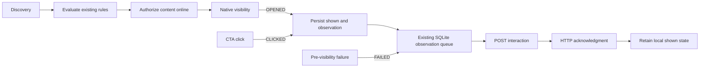

# Android SDK workflow In-app implementation plan

Status (November 4, 2026): workflow support is adapted to the coroutine Actions
and presenter from current `master` (`9665e3af`). Native Gradle verification,
device certification, and release are pending.
Branch: `feat/in-app-workflow`.
Implementation baseline: `9a3efa9fdc1012669a3846dcb7d5a35ccccca24d`.

Use the [shared SDK contract and regression matrix](../../../esputnik-product-docs/changes/CHG-2026-0002-in-app-workflow-delivery/mobile-sdk-implementation-plan.md)
for cross-platform behavior and the
[transport and acknowledgment contract](../../../esputnik-product-docs/changes/CHG-2026-0002-in-app-workflow-delivery/mobile-sdk-implementation-plan.md#workflow-interaction-transport-and-acknowledgment)
for wire details. The [iOS plan](../../../reteno-mobile-ios-sdk/docs/in-app-workflow/README.md)
records platform-specific differences. This document covers Android only.

## Implementation plan

The source changes below use the existing Actions, presenter, and SQLite
managers. They preserve the shared workflow contract.

| Area | Implementation | Acceptance |
| --- | --- | --- |
| Discovery and content | [InAppMessage](../../RetenoSdkCore/src/main/java/com/reteno/core/data/remote/model/iam/message/InAppMessage.kt) decodes optional workflow metadata. Discovery sends `includeWorkflow=true`. Workflow content uses IID/snapshot pairs in `messages`; ordinary content uses a separate `messageInstanceIds` request. | Mixed lists preserve ordinary entries and distinct IIDs sharing a snapshot. Missing/false `inWorkflow` retains ordinary behavior. |
| Execution state | Existing [SQLite message state](../../RetenoSdkCore/src/main/java/com/reteno/core/data/local/model/iam/InAppMessageDb.kt) and interaction rows retain context, IID, snapshot, expiry, and queued observations. | Restart retains independent executions and local suppression. Account changes cannot display old content or replay events under new credentials. |
| Eligibility and rendering | [ShowInAppAction](../../RetenoSdkCore/src/main/java/com/reteno/core/internal/action/iam/ShowInAppAction.kt) reuses existing rules, skips only workflow FREQUENCY, and authorizes content online before first display. The renderer applies the execution's prepared JSON map. | Failed or unsupported enabled conditions defer display. Content is matched by IID/snapshot; expiry and current non-frequency rules are checked before presentation. |
| Visibility and retry | [InAppPresenter](../../RetenoSdkCore/src/main/java/com/reteno/core/internal/iam/InAppPresenter.kt) records actual visibility with the server IID. [PushInAppInteractionsStep](../../RetenoSdkCore/src/main/java/com/reteno/core/internal/action/sync/PushInAppInteractionsStep.kt) uses the existing persistent queue. | OPENED/CLICKED establish local shown state. Retry preserves the original IID, snapshot, UTC-seconds time, and full body. FAILED before visibility does not mark shown; dismissal stays local. |
| Clicks and compatibility | Workflow OPENED, CLICKED, and FAILED use POST interaction. CLICKED retains the full existing CTA action. Ordinary clicks keep PUT. | Persistence and retry preserve `type`, `targetComponentId`, and `url`; ordinary IID generation, frequency records, and click transport remain compatible. |

No delivery-method enum, event identifier, workflow feature flag, SDK TTL
default, or Velocity engine is introduced. Workflow content is not persisted
for offline first display. Repeated discovery or HTTP 304 does not clear shown
state or extend `expiresAt`.

## Android behavior

### Persistence and retry

SQLite upgrades from version 11 to 12 without replacing ordinary message or
frequency data. Workflow columns are added only when absent, including when
upgrading databases that predate the In-app tables. Nullable action JSON is
stored in the existing interaction table.

OPENED and CLICKED rows retain local suppression after acknowledgment or a
terminal response. Separate rows preserve distinct observations for one IID.
The existing scheduler allows three persisted delivery attempts with bounded
backoff and `Retry-After` handling. Retention cleanup bounds pending retries
and removes expired delivered markers. Workflow diagnostics omit interaction
bodies and CTA URLs.

### Presentation and current rules

One presentation guard coordinates workflow display. POSTPONE preserves an
eligible execution paused before content lookup. A pause during lookup releases
the guard; resume requests fresh authorized content.

Background/foreground reattaches an already-visible container only in the same
application/account/device context, without a second OPENED. A changed context
tears it down and releases the view for another IID. Absolute expiry limits
first display; continuing an already-open message does not create a new send.

Message refresh maintains the latest successful bounded rule snapshot.
Segmentation refresh updates the existing segment state on those messages. HTTP/network failures and stale-context responses retain
that snapshot; valid empty responses and HTTP 304 remain distinct outcomes.
Changed non-frequency rules discard an in-flight content attempt and release
its guard before first native presentation. A missing IID alone does not imply
permanent cancellation.

Unsupported targeting compositions, exclusions, or unknown enabled conditions
remain deferred through the existing evaluator. Do not bypass them to display
a workflow message.

### Delivery flow



The [shared acknowledgment contract](../../../esputnik-product-docs/changes/CHG-2026-0002-in-app-workflow-delivery/mobile-sdk-implementation-plan.md#workflow-interaction-transport-and-acknowledgment)
requires synchronous backend shown-state storage for OPENED/CLICKED, followed by
Kafka broker acknowledgment before HTTP success. FAILED does not update shown
state. Backend storage and publication are not atomic; retry the saved body
without redisplaying the IID. Cross-device exactly-once display and event-level
exactly-once analytics are not guaranteed.

## Verification

The six earlier review passes apply to the implementation before the upstream
coroutine refactor. The merge adapts that implementation to the new boundaries.

| Check | Recorded result |
| --- | --- |
| Upstream base | Reconciled with `origin/master` at `9665e3af`; deleted repositories, controllers, and service locators stay deleted. |
| Kotlin compilation | Standalone Kotlin 1.8 compilation succeeds for 677 main, debug, test, and fixture source files with resolved Gradle dependencies and temporary generated resource stubs. This is not an Android Gradle Plugin build. |
| Focused tests | 321 Actions, presenter, rules, sync, and HTTP tests pass through a standalone JUnit launcher. |
| SQLite tests | 37 Robolectric tests pass, including workflow persistence and upgrades from historical schemas through version 11. The standalone runner uses Android OS resources without the app manifest. |
| Gradle/native tests and Kover | Blocked before compilation: Android SDK location is missing. |
| Devices, renderer, wrappers, backend integration | Pending. |

The focused regressions are in
[WorkflowDeliveryTest](../../RetenoSdkCore/src/test/java/com/reteno/core/internal/action/iam/WorkflowDeliveryTest.kt),
[WorkflowStorageTest](../../RetenoSdkCore/src/test/java/com/reteno/core/data/local/database/manager/WorkflowStorageTest.kt),
[FetchInAppMessagesActionTest](../../RetenoSdkCore/src/test/java/com/reteno/core/internal/action/iam/FetchInAppMessagesActionTest.kt),
and [InAppPresenterTest](../../RetenoSdkCore/src/test/java/com/reteno/core/internal/iam/InAppPresenterTest.kt).
They cover mixed discovery, same-snapshot personalization, persisted shown state,
full CTA retries, native presentation acknowledgment, context changes, and rule
changes before visibility.

Configure the Android SDK and JDK 17, then run from the repository root:

```bash
./gradlew :RetenoSdkCore:testDebugUnitTest --configure-on-demand --tests com.reteno.core.internal.action.iam.WorkflowDeliveryTest --tests com.reteno.core.data.local.database.manager.WorkflowStorageTest --tests com.reteno.core.internal.action.iam.FetchInAppMessagesActionTest --tests com.reteno.core.internal.iam.InAppPresenterTest
./gradlew :RetenoSdkCore:testDebugUnitTest :RetenoSdkCore:koverVerifyDebug --configure-on-demand
```

## Remaining work

- Run the native Gradle tests and coverage gate with a configured Android SDK.
- Verify store upgrades, actual visibility, background/foreground, process
  death, reconnect, expiry, clicks, dismissal, and account changes on devices.
- Certify supported renderer/wrapper versions and backend integration. Showing
  E1 must leave a different IID E2 independently available.
- Record the evidence and publish through the SDK release process only after
  certification. Source checks do not establish SDK release readiness.
